# Python matplotlib Cheat Sheet

Matplotlib is a Python library for creating static, animated, and visualized charts from data.

## introduction

```python
#Checking if Python is installed
python3 --version

#Checking if pip is installed
python3 -m pip --version

#if not installed
sudo apt install python3-pip

#create project
mkdir myproject
cd myproject
python3 -m venv .venv
source .venv/bin/activate
``` 

---

## install matplotlib

```python
#without venv
python -m pip install matplotlib
#with venv
pip install matplotlib
```

## use-library

You’ll also need to import matplotlib to get started

```python
import matplotlib.pyplot as plt
```
> The standard convention is to import pyplot as plt.

---
---

## easy plot

```python
x = [1, 2, 3, 4, 5]
y = [1, 4, 9, 16, 25]

# create plot
plt.plot(x, y)
# show the plot
plt.show()
```

### result

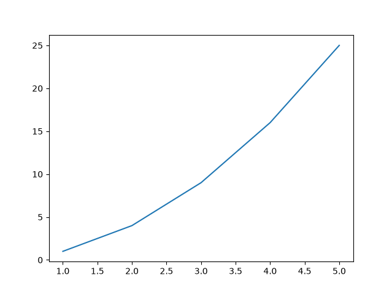

---

## label

```python
# create a label in plot (show this with "plt.legend()")
plt.plot(x, y, label="y = x²")

#writes the chart title above it.

plt.title("First Plot")

# label for x
plt.xlabel("X Axis")

# label for y
plt.ylabel("Y Axis")

# show the label about the line
plt.legend()

# It brightens the faint background lines.
plt.grid(True)

# show plot in the window
plt.show()
```

---


## Customize the font

```python
plt.plot(x, y,
         color="red",        # color line
         linestyle="--",     # line type: - -- -. :
         linewidth=2,        # Thickness
         marker="o",         # Indicator: o s ^ * x
         markersize=8)
``` 

> Quick shortcut: `plt.plot(x, y, "ro--")` means red, circle, dashed line.

---

## multiple line in one plot

```python
import matplotlib.pyplot as plt

x = [6,7,8,9,10]
y = [1,2,3,4,5]
plt.plot(x,  label="line1")
plt.plot(y,  label="line2")
plt.legend()
plt.show()
```

### result

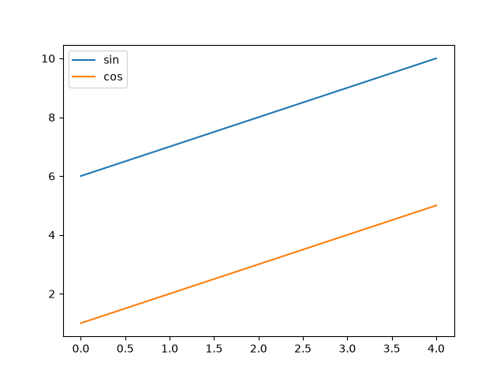

---

## Professional approach

```python
import numpy as np
import matplotlib.pyplot as plt

x = np.linspace(0, 10, 100)

# ax is plot name and set size window
fig, ax = plt.subplots(figsize=(8, 5))

ax.plot(x, np.sin(x), color="blue")
ax.set_title("Sine Wave")
ax.set_xlabel("x")
ax.set_ylabel("sin(x)")
ax.set_xlim(0, 10)
ax.set_ylim(-1.5, 1.5)

plt.show()	
```

### result

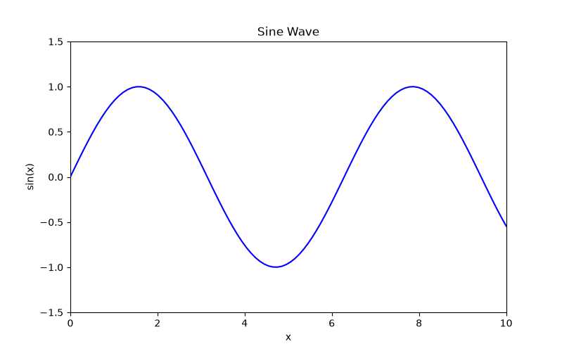

---

## Multiple charts in a single image

```python
import numpy as np
import matplotlib.pyplot as plt

x = np.linspace(0, 10, 100)

# 2*2
fig, axs = plt.subplots(2, 2, figsize=(10, 8))

axs[0, 0].plot(x, np.sin(x))
axs[0, 0].set_title("sin")

axs[0, 1].plot(x, np.cos(x), color="orange")
axs[0, 1].set_title("cos")

axs[1, 0].plot(x, x**2, color="green")
axs[1, 0].set_title("x²")

axs[1, 1].plot(x, np.sqrt(x), color="red")
axs[1, 1].set_title("√x")

plt.tight_layout()   # Preventing overlap
plt.show()
```

### result

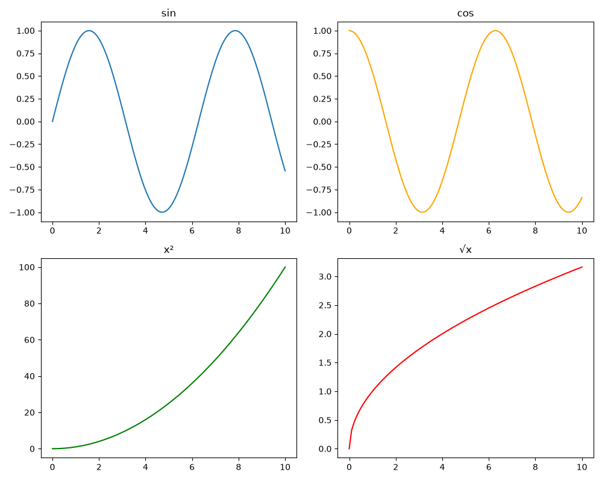


---

## Types of plots

### bar type

```python
names = ["A", "B", "C", "D"]
values = [23, 45, 12, 38]

fig, ax = plt.subplots()
ax.bar(names, values, color="skyblue", edgecolor="black")
plt.show()
```
> `ax.barh(names, values)` Horizontal

> `ax.bar(names, values)` Vertical

### result

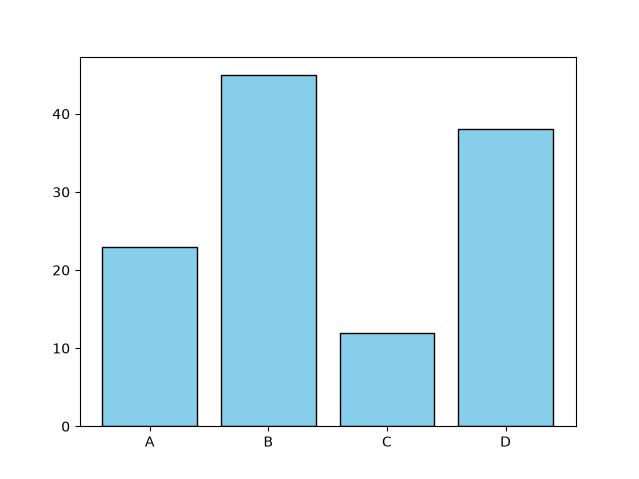

### Scatter type

```python
import numpy as np
import matplotlib.pyplot as plt

np.random.seed(0)
x = np.random.rand(50)
y = np.random.rand(50)
sizes = np.random.rand(50) * 300
colors = np.random.rand(50)

plt.scatter(x, y, s=sizes, c=colors, alpha=0.6, cmap="viridis")
plt.colorbar(label="blue")
plt.show()
```

> x, y : Coordinates of each point

> s=sizes : size any point

> c=colors : The value used to determine the color of each point

> alpha=0.6 : Transparency: 0 is completely invisible, and 1 is completely opaque. At 0.6, overlapping dots are still visible.

> cmap="viridis" : The color map converts small numbers to purple and large numbers to yellow.


### result

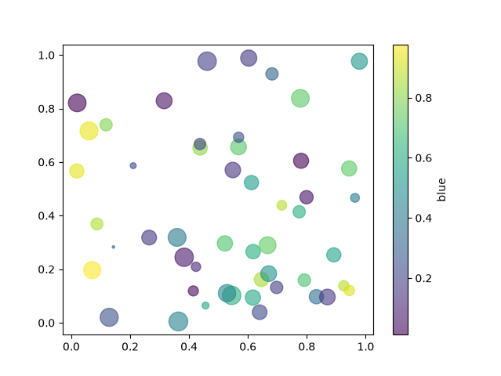

### histogram

```python
data = np.random.randn(1000)
plt.hist(data, bins=30, color="purple", edgecolor="white")
plt.show()
```

### result

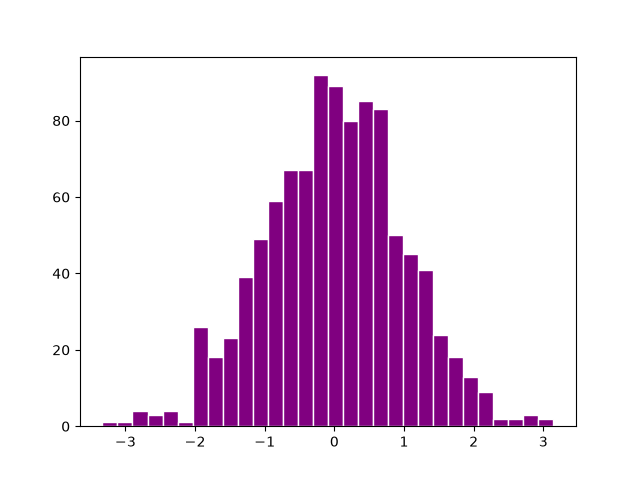

### pie type

```python
sizes = [30, 25, 25, 20]
labels = ["A","B","C","D"]
plt.pie(sizes, labels=labels, autopct="%1.1f%%", startangle=90,
        explode=(0.1, 0, 0, 0))
plt.show()
```

### result

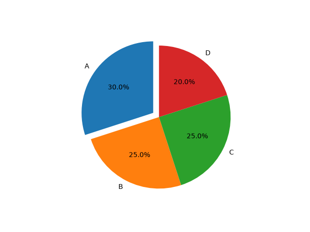

### Box Plot

```python
data = [np.random.randn(100) * s for s in (1, 2, 3)]
plt.boxplot(data, tick_labels=["G1", "G2", "G3"])
plt.show()
```

### result

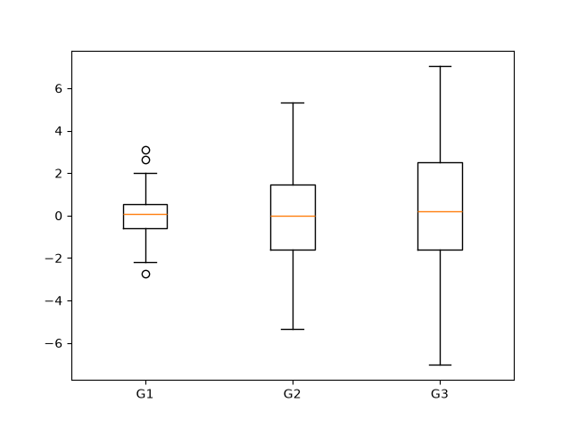


### Fill Between

```python
x = np.linspace(0, 10, 100)
plt.plot(x, np.sin(x))
plt.fill_between(x, np.sin(x), alpha=0.3)
plt.show()
```

### result

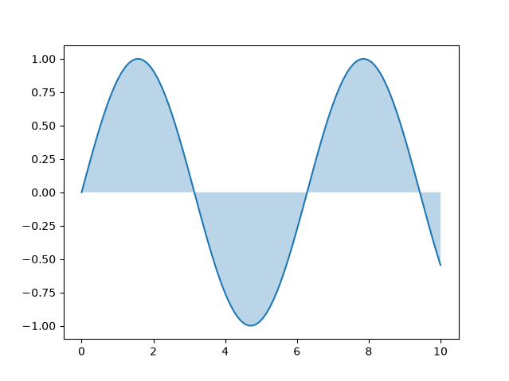


### Heatmap

```python
matrix = np.random.rand(10, 10)
plt.imshow(matrix, cmap="hot")
plt.colorbar()
plt.show()
```


### result

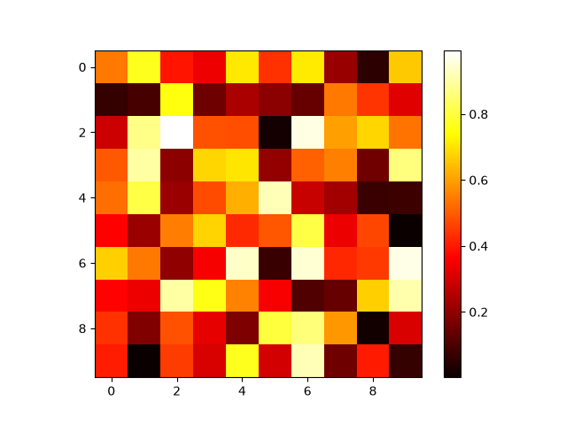


### Error Bar

```python
x = np.arange(5)
y = [2, 4, 3, 5, 4]
err = [0.5, 0.3, 0.4, 0.6, 0.2]
plt.errorbar(x, y, yerr=err, fmt="o-", capsize=5)
plt.show()
```

### result

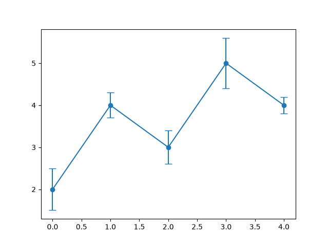


### Text, Flash, and Annotations

```python
x = np.linspace(0, 10, 100)       # 100 evenly spaced points from 0 to 10
fig, ax = plt.subplots()          # create figure and axes
ax.plot(x, np.sin(x))             # plot sine curve

ax.text(5, 0.5, "A simple text")  # plain text at point (5, 0.5)

ax.annotate("Maximum",
            xy=(np.pi/2, 1),       # point the arrow points to (sine peak)
            xytext=(3, 1.2),       # position of the text
            arrowprops=dict(arrowstyle="->", color="red"))  # red arrow

plt.show()                        # display the plot
```


### result

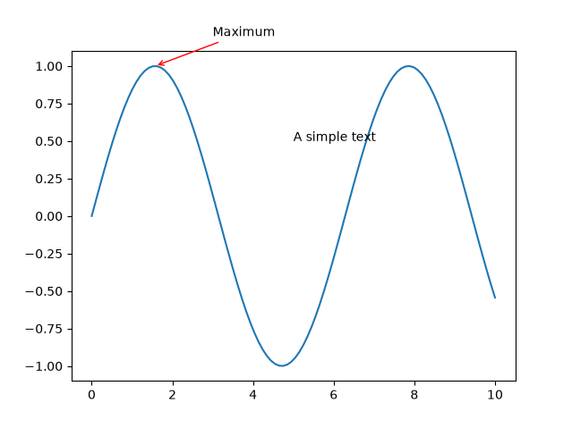


### Auxiliary lines

```python
ax.axhline(0, color="gray", linestyle="--")   # خط افقی
ax.axvline(5, color="gray", linestyle=":")    # خط عمودی
ax.axvspan(2, 4, alpha=0.2)                   # ناحیه عمودی
```

### EXAMPLE

```python
import numpy as np
import matplotlib.pyplot as plt

x = np.linspace(0, 10, 100)

fig, ax = plt.subplots(figsize=(8, 5))
ax.plot(x, np.sin(x), color="blue", label="sin(x)")

ax.axhline(0, color="gray", linestyle="--")   # خط افقی روی y=0
ax.axvline(5, color="gray", linestyle=":")    # خط عمودی روی x=5
ax.axvspan(2, 4, alpha=0.2, color="orange")   # ناحیه سایه‌دار بین x=2 تا x=4

ax.legend()
plt.show()
```

### result

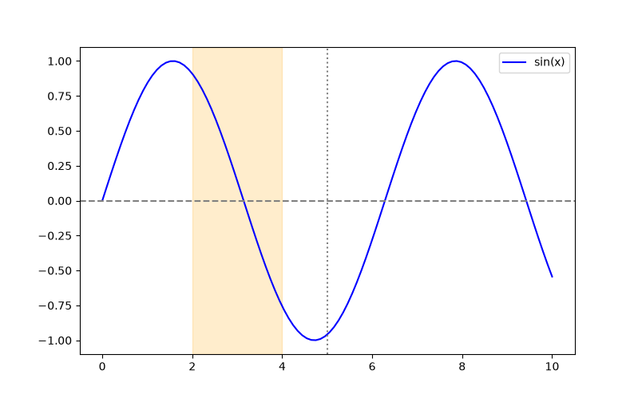


### Two Y-axes

```python
x = np.linspace(0, 10, 100)

fig, ax1 = plt.subplots()

# Left
ax1.plot(x, np.sin(x), "b")
ax1.set_ylabel("temperature", color="b")
ax1.tick_params(axis="y", colors="b")

# Right
ax2 = ax1.twinx()
ax2.plot(x, np.exp(x/5), "r")
ax2.set_ylabel("pressure", color="r")
ax2.tick_params(axis="y", colors="r")
```

### result

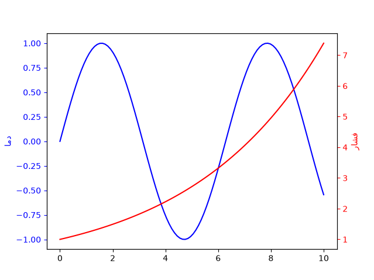

---

## colors

Colors can be specified in the following formats: a name ("red"), a hex code ("#FF5733"), an RGB tuple ((0.2, 0.4, 0.6)), or a single-character code ("r").

Ready-made styles

```python
# see the all style
print(plt.style.available)
# for example (ggplot)
plt.style.use("ggplot")        # seaborn-v0_8, dark_background, fivethirtyeight
```

### EXAMPLE

```python
x = np.linspace(0, 10, 100)

plt.style.use("ggplot")

fig, ax = plt.subplots(figsize=(8, 5))
ax.plot(x, np.sin(x), label="sin(x)")
ax.legend()
plt.show()

```

### result

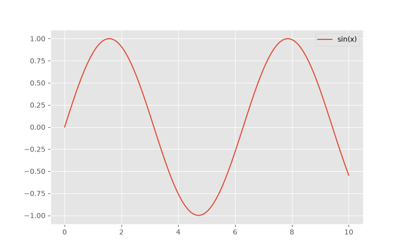


---

## save plot

```python
# High-quality PNG (300 dpi) with no extra margins
fig.savefig("chart.png", dpi=300, bbox_inches="tight")
# pdf for articles
fig.savefig("chart.pdf")
# svg for web
fig.savefig("chart.svg")
# PNG with a transparent background (for placing over a color of your choice)
fig.savefig("chart.png", transparent=True)
```

> Make sure to call `savefig` before `plt.show()`.

---

## work with pandas

```python
import pandas as pd

df = pd.DataFrame({
    "month": ["Jan", "Feb", "Mar", "Apr"],
    "sales": [100, 150, 130, 180]
})

fig, ax = plt.subplots()
ax.plot(df["month"], df["sales"], marker="o")
plt.show()
```

### result

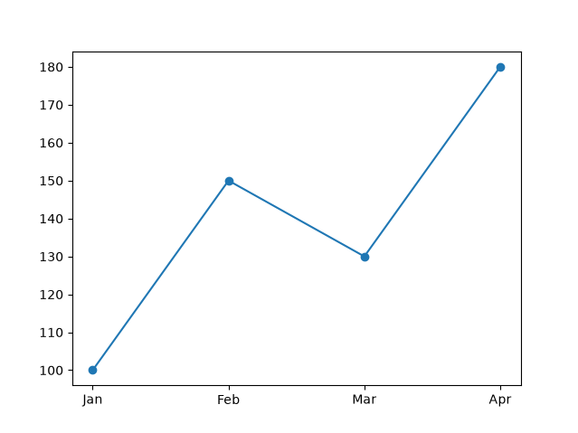


---

## 3D plot

```python
fig = plt.figure()                        # create empty figure
ax = fig.add_subplot(projection="3d")     # add a 3D axes

X, Y = np.meshgrid(np.linspace(-3, 3, 50),
                   np.linspace(-3, 3, 50))  # build a 2D grid of points

Z = np.sin(np.sqrt(X**2 + Y**2))          # compute height Z over the grid

ax.plot_surface(X, Y, Z, cmap="viridis")  # draw 3D surface with viridis colormap
plt.show()                                # display the plot
```

### result

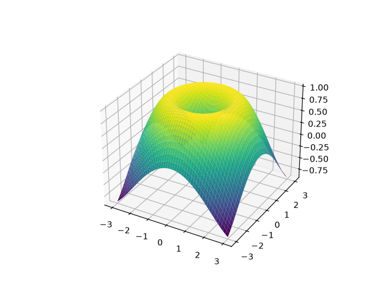

---

## animation

```python
from matplotlib.animation import FuncAnimation

fig, ax = plt.subplots()
x = np.linspace(0, 2*np.pi, 200)
line, = ax.plot(x, np.sin(x))

def update(frame):
    line.set_ydata(np.sin(x + frame/10))
    return line,

ani = FuncAnimation(fig, update, frames=100, interval=30, blit=True)
plt.show()
```

> for save this `ani.save("wave.gif", writer="pillow")`

### result

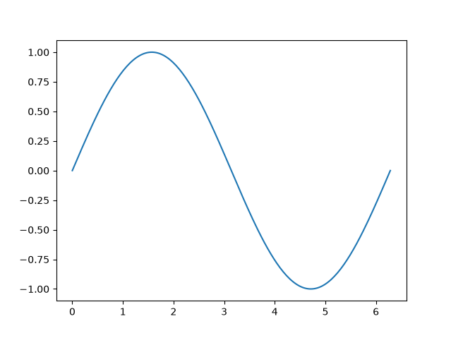

---

